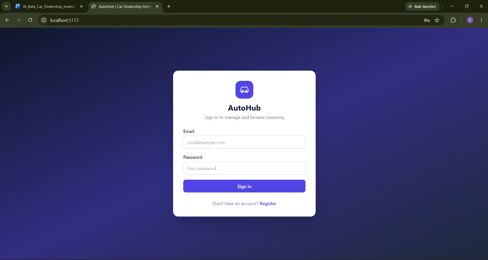
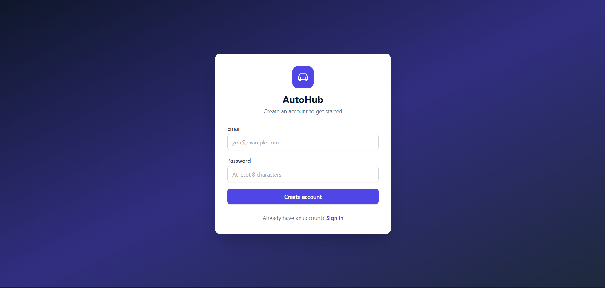
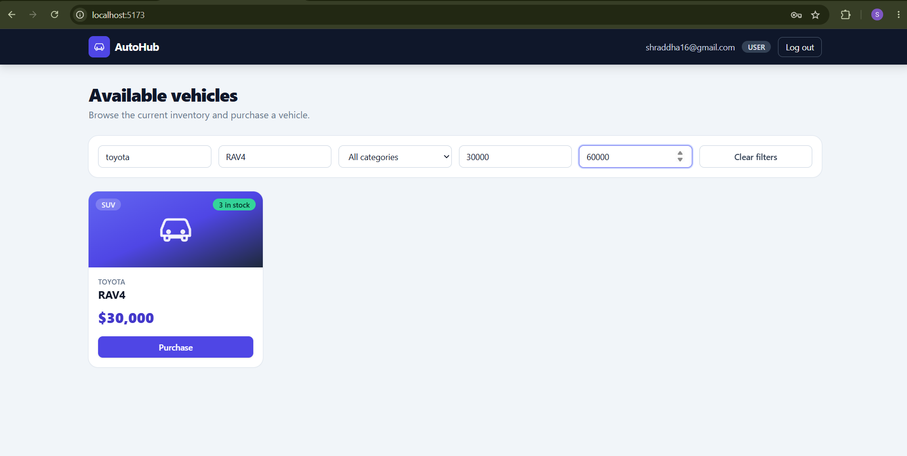
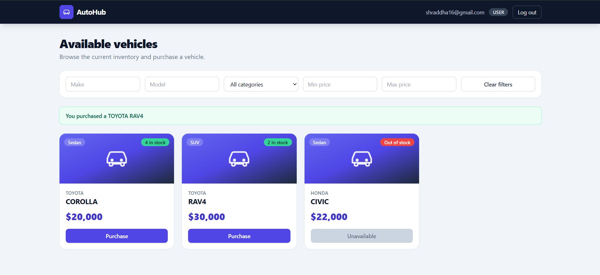
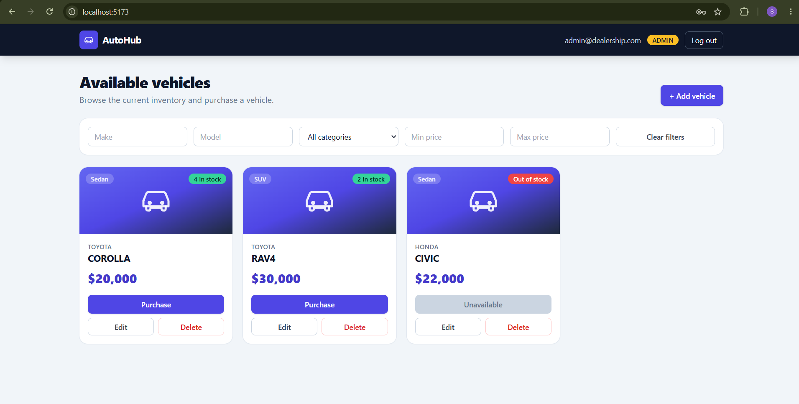
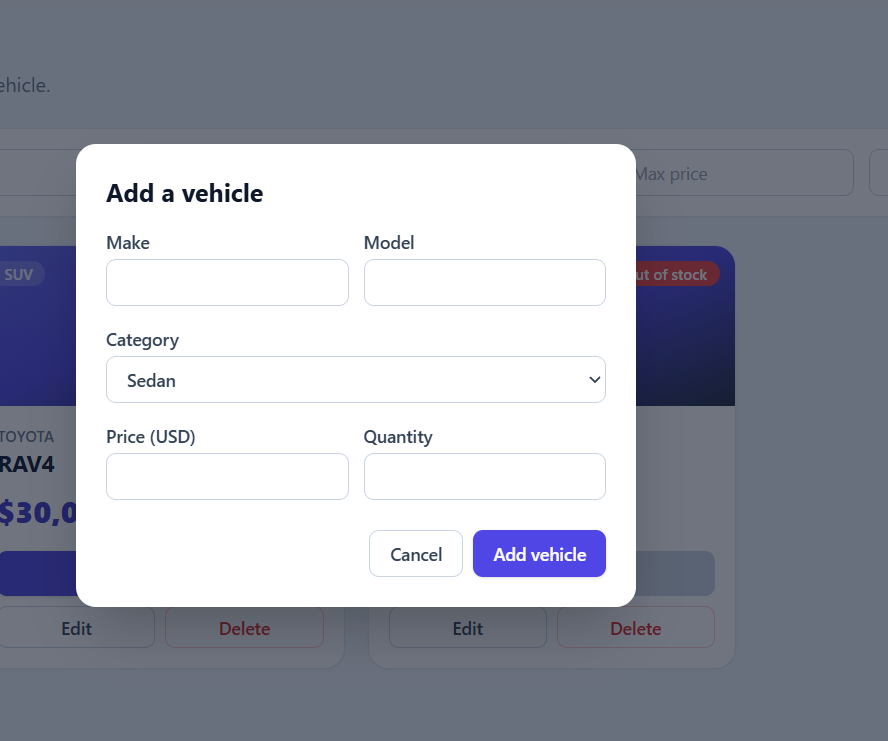
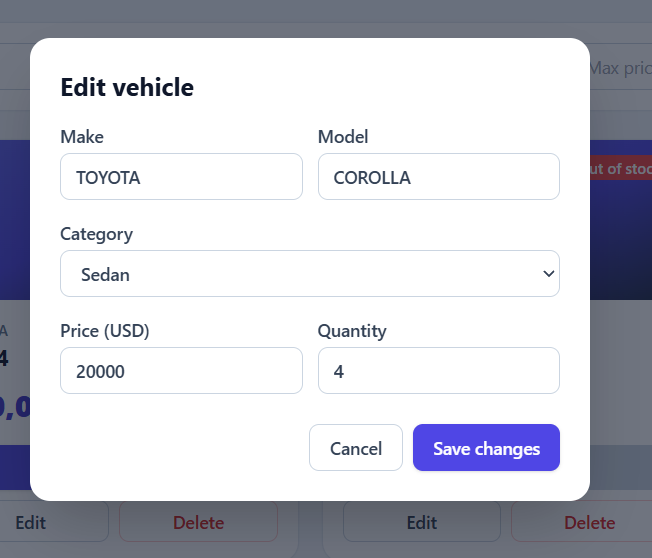
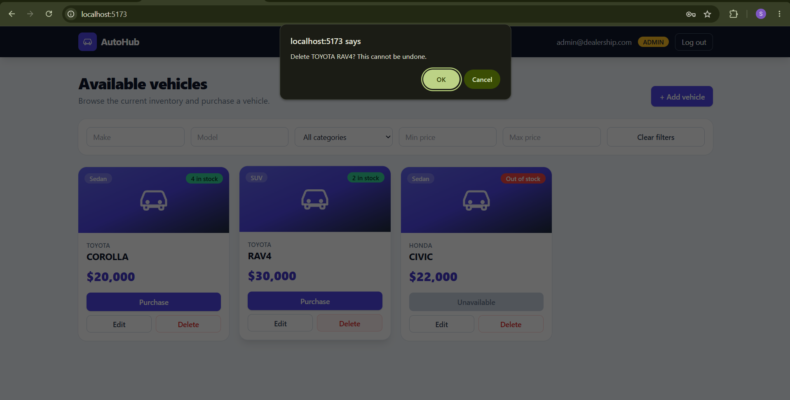

# AutoHub – Car Dealership Inventory System

A full-stack Car Dealership Inventory System built for the TDD kata.
Users register and log in, browse and search the inventory, and purchase vehicles.
Admins can additionally add, update and delete vehicles and restock inventory.

## Tech stack

| Layer | Technology |
|-------|------------|
| Backend | Node.js, Express 5 |
| Database | SQLite (file-based, via `better-sqlite3`) |
| Auth | JWT (`jsonwebtoken`) + `bcryptjs` password hashing |
| Tests | Jest + Supertest (real SQLite file per test) |
| Frontend | React 18, Vite, Tailwind CSS 3, HTML5/CSS3 |

## Project structure

```
backend/
  src/
    config.js            environment configuration
    database.js          SQLite connection + schema
    errors.js            HTTP-aware error classes
    repositories/        SQL access (users, vehicles)
    services/            business rules (auth, vehicles/inventory)
    validators/          input validation and parsing
    middleware/          JWT authentication, admin check, error handling
    routes/              Express routers
    app.js               composition root (wires everything together)
    server.js            starts the HTTP server
    seedAdmin.js         creates the admin account
  tests/                 Jest test suites
frontend/
  src/
    api.js               API client
    context/             authentication state
    components/          UI components
```

The backend follows a layered design: routes -> services -> repositories.
Each class has one responsibility (SRP), dependencies are injected through constructors (DIP),
and the composition root is the only place that knows the concrete classes.

## Setup

Prerequisites: Node.js 20 or newer (developed for Node 24 / npm 11) and Git.
The SQLite driver (`better-sqlite3`) ships prebuilt binaries for current Node versions, so no C++ build tools are normally needed.

On Windows PowerShell, if `npm` is blocked by "running scripts is disabled", run once:

```powershell
Set-ExecutionPolicy -Scope CurrentUser -ExecutionPolicy RemoteSigned
```

### Backend (terminal 1)

```bash
cd backend
npm install
```

Create the settings file, then set `JWT_SECRET` inside `.env` to a long random string:

```bash
# Windows (PowerShell / cmd)
copy .env.example .env
# macOS / Linux
cp .env.example .env
```

```bash
npm run seed:admin          # creates the admin account (see below)
npm run dev                 # API on http://localhost:4000
```

The SQLite database file is created automatically at `backend/data/dealership.db`.

**Admin account:** public registration always creates a regular `user`.
`npm run seed:admin` creates an admin using `ADMIN_EMAIL` / `ADMIN_PASSWORD` from `.env`
(defaults: `admin@dealership.com` / `Admin@12345`).

### Frontend (terminal 2)

```bash
cd frontend
npm install
npm run dev                 # app on http://localhost:5173
```

The Vite dev server proxies `/api` to `http://localhost:4000`, so start the backend first.
For a production build use `npm run build`; set `VITE_API_URL` to the deployed API URL if it is hosted separately.

## API

All `/api/vehicles` routes require the header `Authorization: Bearer <token>`.

| Method | Endpoint | Access | Description |
|--------|----------|--------|-------------|
| POST | `/api/auth/register` | public | Register `{ email, password }` (min 8 chars) |
| POST | `/api/auth/login` | public | Returns `{ token, user }` |
| POST | `/api/vehicles` | user | Add a vehicle `{ make, model, category, price, quantity }` |
| GET | `/api/vehicles` | user | List all vehicles |
| GET | `/api/vehicles/search` | user | Query: `make`, `model`, `category`, `minPrice`, `maxPrice` |
| PUT | `/api/vehicles/:id` | user | Update any of the vehicle fields |
| DELETE | `/api/vehicles/:id` | admin | Delete a vehicle (204) |
| POST | `/api/vehicles/:id/purchase` | user | Decrease quantity by `quantity` (default 1); 409 if insufficient stock |
| POST | `/api/vehicles/:id/restock` | admin | Increase quantity by `quantity` |

Errors are returned as `{ "error": "message" }` with status 400, 401, 403, 404 or 409.

## Running the tests

```bash
cd backend
npm test                    # runs all tests with a coverage summary
npm run test:report         # writes the full verbose output to backend/test-report.txt
```

Tests run against a real SQLite file created in a temporary directory for every test.

## Test report

<!-- Run `npm run test:report` in backend/ and paste the contents of test-report.txt below. -->

```
PASS tests/vehicles.test.js
  Vehicles API
    POST /api/vehicles
      √ adds a vehicle with a unique id (217 ms)
      √ trims text fields (66 ms)
      √ rejects a missing make with 400 (63 ms)
      √ rejects an empty model with 400 (58 ms)
      √ rejects a missing category with 400 (58 ms)
      √ rejects a negative price with 400 (59 ms)
      √ rejects a non-numeric price with 400 (63 ms)
      √ rejects a missing quantity with 400 (63 ms)
      √ rejects a fractional quantity with 400 (56 ms)
      √ rejects a negative quantity with 400 (55 ms)
      √ rejects an over-long make with 400 (54 ms)
      √ rejects a request without a body with 400 (53 ms)
      √ rejects unauthenticated requests with 401 (52 ms)
    GET /api/vehicles
      √ returns an empty list when nothing has been added (54 ms)
      √ returns every vehicle, including those out of stock (73 ms)
    GET /api/vehicles/search
      √ returns all vehicles when no filter is given (89 ms)
      √ filters by make, case-insensitively and partially (92 ms)
      √ filters by model (90 ms)
      √ filters by category, case-insensitively (90 ms)
      √ filters by an inclusive price range (87 ms)
      √ filters by minPrice only (88 ms)
      √ filters by maxPrice only (85 ms)
      √ combines filters (92 ms)
      √ returns an empty list when nothing matches (97 ms)
      √ treats SQL wildcards in input literally (95 ms)
      √ ignores blank filters (91 ms)
      √ rejects a non-numeric minPrice with 400 (87 ms)
      √ rejects a negative maxPrice with 400 (89 ms)
      √ rejects minPrice greater than maxPrice with 400 (88 ms)
      √ rejects a repeated make parameter with 400 (89 ms)
      √ requires authentication (92 ms)
    PUT /api/vehicles/:id
      √ updates the supplied fields and keeps the rest (76 ms)
      √ returns 404 for an unknown vehicle (63 ms)
      √ returns 400 for an invalid id (65 ms)
      √ returns 400 for invalid data (68 ms)
      √ returns 400 when no updatable field is provided (69 ms)
    DELETE /api/vehicles/:id
      √ lets an admin delete a vehicle (80 ms)
      √ forbids a regular user with 403 (66 ms)
      √ returns 404 for an unknown vehicle (52 ms)
      √ returns 401 without a token (54 ms)

PASS tests/inventory.test.js
  Inventory API
    POST /api/vehicles/:id/purchase
      √ decreases the quantity by one by default (123 ms)
      √ decreases the quantity by the requested amount (79 ms)
      √ allows buying the last unit (72 ms)
      √ returns 409 when the vehicle is out of stock (69 ms)
      √ returns 409 and leaves stock untouched when asking for more than available (70 ms)
      √ rejects quantity 0 with 400 (65 ms)
      √ rejects quantity -1 with 400 (68 ms)
      √ rejects quantity 1.5 with 400 (72 ms)
      √ rejects quantity "2" with 400 (68 ms)
      √ returns 404 for an unknown vehicle (56 ms)
      √ returns 400 for an invalid id (52 ms)
      √ requires authentication (53 ms)
    POST /api/vehicles/:id/restock
      √ lets an admin increase the quantity (70 ms)
      √ forbids a regular user with 403 (63 ms)
      √ rejects quantity undefined with 400 (62 ms)
      √ rejects quantity 0 with 400 (64 ms)
      √ rejects quantity -4 with 400 (66 ms)
      √ rejects quantity 2.5 with 400 (69 ms)
      √ returns 404 for an unknown vehicle (55 ms)
      √ requires authentication (58 ms)

PASS tests/auth.test.js
  Auth API
    √ returns 404 JSON for unknown routes (21 ms)
    POST /api/auth/register
      √ creates a user and never returns the password (63 ms)
      √ ignores a role supplied by the client (30 ms)
      √ rejects a duplicate email with 409 (33 ms)
      √ rejects an invalid email with 400 (21 ms)
      √ rejects a missing email with 400 (20 ms)
      √ rejects a short password with 400 (22 ms)
      √ rejects a missing password with 400 (21 ms)
      √ rejects a request without a body with 400 (21 ms)
      √ rejects malformed JSON with 400 (23 ms)
    POST /api/auth/login
      √ returns a token and the public user for valid credentials (38 ms)
      √ rejects a wrong password with 401 (36 ms)
      √ rejects an unknown email with 401 (35 ms)
      √ rejects a missing password with 400 (34 ms)
    token protection
      √ rejects requests without a token (21 ms)
      √ rejects requests with an invalid token (80 ms)
      √ accepts requests with a valid token (41 ms)

-----------------------|---------|----------|---------|---------|-------------------
File                   | % Stmts | % Branch | % Funcs | % Lines | Uncovered Line #s 
-----------------------|---------|----------|---------|---------|-------------------
All files              |   96.52 |       82 |     100 |   96.36 |                   
 src                   |   88.88 |        0 |     100 |   88.88 |                   
  app.js               |     100 |      100 |     100 |     100 |                   
  config.js            |       0 |        0 |     100 |       0 | 1-8               
  database.js          |     100 |      100 |     100 |     100 |                   
  errors.js            |     100 |        0 |     100 |     100 | 17-29             
 src/middleware        |   85.71 |    68.75 |     100 |   85.71 |                   
  authMiddleware.js    |     100 |      100 |     100 |     100 |                   
  errorHandler.js      |   69.23 |     37.5 |     100 |   69.23 | 16-20             
 src/repositories      |     100 |       85 |     100 |     100 |                   
  userRepository.js    |     100 |    66.66 |     100 |     100 | 11                
  vehicleRepository.js |     100 |    88.23 |     100 |     100 | 42,74             
 src/routes            |     100 |      100 |     100 |     100 |                   
  authRoutes.js        |     100 |      100 |     100 |     100 |                   
  vehicleRoutes.js     |     100 |      100 |     100 |     100 |                   
 src/services          |     100 |    94.11 |     100 |     100 |                   
  authService.js       |     100 |    88.88 |     100 |     100 | 12                
  vehicleService.js    |     100 |      100 |     100 |     100 |                   
 src/validators        |   98.64 |    96.34 |     100 |    98.5 |                   
  authValidator.js     |   92.85 |    94.44 |     100 |   92.85 | 9                 
  vehicleValidator.js  |     100 |    96.87 |     100 |     100 | 80,93             
-----------------------|---------|----------|---------|---------|-------------------
Test Suites: 3 passed, 3 total
Tests:       77 passed, 77 total
Snapshots:   0 total
Time:        7.595 s, estimated 8 s
Ran all test suites.

```

## Screenshots

### Authentication

**Login**



**Register**



### Regular user

**Dashboard** – all vehicles; the Purchase button is disabled for the out-of-stock vehicle.


**Search and filters** – make, model, category and price range combined.



**Purchase** – buying a vehicle shows a confirmation and decreases its stock.



### Admin user

**Admin dashboard** – adds the Add vehicle button and Edit/Delete on every vehicle.



**Add a vehicle**



**Edit a vehicle**



**Delete a vehicle** – asks for confirmation first.



## My AI Usage

**Tools used:** Claude (Anthropic).

**How I used it:**
- Generated the backend (Express routes, services, repositories, validators, JWT auth) and the SQLite schema.
- Generated the Jest/Supertest test suites for authentication, vehicles, search and inventory.
- Generated the React + Tailwind frontend (login/register, dashboard, search filters, purchase button, admin forms).
- Generated the initial structure of this README.

**Reflection:**

<!-- Write your own reflection here: what the AI did well, what you had to fix or change, what you reviewed and understood, and how it changed your workflow. -->
AI did most of the code generation on this project: Claude wrote the Express backend, the SQLite schema, the JWT authentication, the Jest/Supertest tests, the React and Tailwind frontend, and the first draft of this README. I did not take it on trust. I set it up on my own machine, fixed the PowerShell and npm install problems that came up, ran the backend and frontend together, and tested the application by hand as both a regular user and an admin. By hand I registered and logged in, added, edited and deleted vehicles, searched with several filters, bought a vehicle, and confirmed that the Purchase button is disabled when the quantity is zero. I also ran the automated test suite myself, and all 77 tests passed with about 96% statement coverage. I checked the application against the kata PDF and asked Claude questions where I was unsure, for example why an admin can also purchase a vehicle, and learned that it follows the PDF, which only marks delete and restock as admin-only. The main thing I learned is how a full-stack app fits together: a React frontend calls a REST API, the API checks a JWT token, and the data lives in a SQLite file. AI made me much faster at getting a working app and tests, but because I did not write the code line by line, I had to spend extra time understanding it so I could explain it in the interview. If I did this again, I would write the failing tests myself first, so the red-green-refactor history in git shows my own TDD process.

Full chat logs are in [PROMPTS.md](PROMPTS.md).

## Live deployment

Not deployed.
